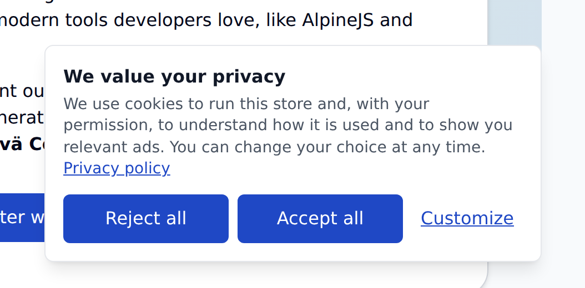
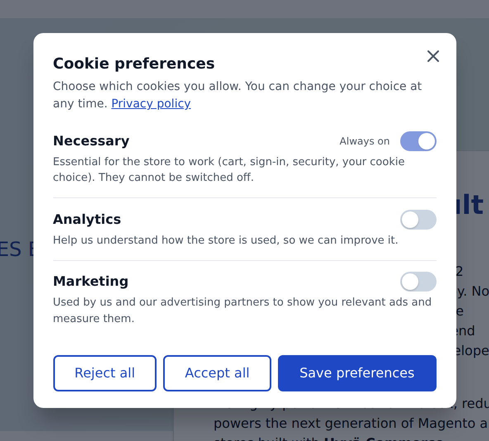
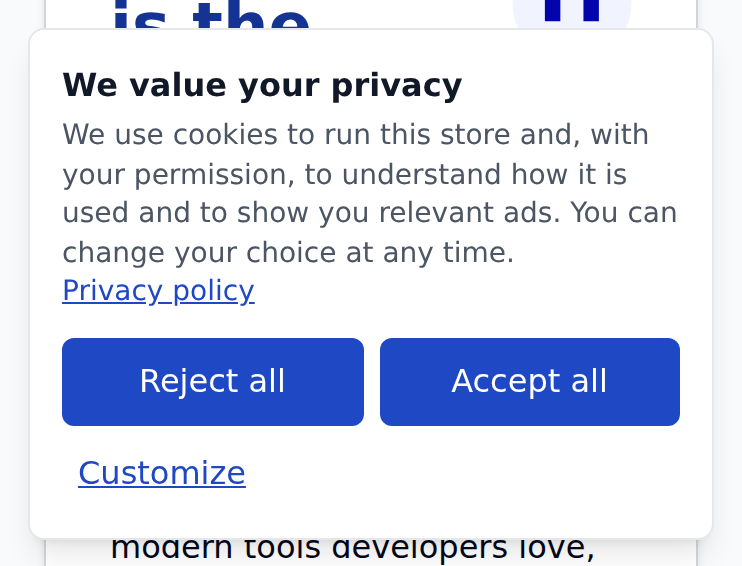

# Slova Cookie Consent — free cookie consent banner for Magento 2 and Hyvä

A cookie consent banner for Magento 2 stores on Hyvä: **Reject all** as easy as **Accept all**, a choice per category, nothing optional before the visitor answers, **Google Consent Mode v2** set before any Google tag (Google Tag Manager included), and a way back to the settings on every page. Free, MIT-licensed, no account and no external service.



## What it does

- **Reject as easy as Accept.** *Reject all* and *Accept all* have the same size and colour, side by side; *Customize* opens one switch per category. Nothing optional is on until the visitor says so, and the banner does not close without an answer.
- **Categories you choose.** Necessary (always on), Preferences, Analytics and Marketing; offer only the ones your store uses, per store view. Add your own from `di.xml`.
- **Google Consent Mode v2, before any Google tag.** All optional signals are denied right after `<title>` — before any Google tag, Google Tag Manager included, even when its snippet sits in *HTML Head > Scripts and Style Sheets* — and updated the moment the visitor chooses. Returning visitors get their stored choice before the first tag fires.
- **Blocks other scripts until consent.** Mark a script `type="text/plain" data-consent="marketing"`, or an iframe with `data-consent` and `data-src`, and it runs only once its categories are allowed.
- **Withdrawal on every page.** A small corner button, any link to `#cookie-settings` (put one in your footer) and `window.slovaConsent.open()`. Withdrawing a category reloads the page so scripts that already ran stop.
- **Built for Hyvä.** Works with Alpine's CSP build, no inline scripts or styles, no Tailwind rebuild, safe in the full page cache. 4.4 KB of JavaScript gzipped, both files together (`consent.js` 3.4 KB, `consent-mode.js` 1.1 KB, measured with `gzip -9` on 1.0.0). Follows your theme's primary color.
- **Replaces Magento's Cookie Restriction Mode** and silences its notice while enabled.
- **For developers:** a browser API and events (mirrored into `dataLayer` for Google Tag Manager) and a server-side PHP class for code that must respect consent.
- **Translated** into English, Romanian, German, French, Spanish, Italian and Dutch.

### What it does not do

It does not scan your store for cookies, keep a server-side log of consents, adapt the banner to the visitor's country, or implement the IAB TCF framework. If you need any of those, a hosted consent platform (Cookiebot, Usercentrics, CookieYes…) is the better tool.

The module gives you the mechanics: the choice, the categories, the Consent Mode signals and the scripts held back until consent. Whether your store complies with the rules that apply to it also depends on the scripts you run, your privacy policy and the texts you choose; check those with your legal adviser.

### Screenshots

Taken on the Hyvä default theme with the module's default settings.



*Customize opens one switch per category; the optional ones are off until the visitor turns them on.*



*On a phone the two buttons stay side by side, the same size.*

## Requirements

| Requirement | Supported |
|---|---|
| Magento Open Source | 2.4.8 (tested on 2.4.8-p5) |
| Adobe Commerce | Not tested yet |
| Hyvä Theme | 1.3 or newer (tested on 1.5.3) |
| PHP | 8.3 – 8.4 |

The storefront part uses Hyvä's Alpine.js; Luma storefronts are not supported. `hyva-themes/magento2-theme-module` comes from Hyvä's own Composer repository, which every Hyvä store already has configured.

## Installation

```bash
composer require slova/module-cookie-consent
bin/magento module:enable Slova_CookieConsent
bin/magento setup:upgrade
bin/magento setup:di:compile          # production mode
bin/magento cache:flush
```

The banner appears right away with sensible defaults. Then:

1. Set **Stores → Configuration → General → Web → Default Cookie Settings → Cookie Restriction Mode** to **No** (this module replaces it).
2. Point **Privacy Policy Link** at your policy page.
3. Mark the scripts that need consent (see *Blocking scripts until consent*), or rely on Consent Mode for Google tags.
4. Check that it works (see *Checking that it works*).

### Upgrading

```bash
composer update slova/module-cookie-consent
bin/magento setup:upgrade
bin/magento cache:flush
```

### Uninstalling

```bash
bin/magento module:uninstall Slova_CookieConsent --remove-data
```

`--remove-data` deletes the module's settings (`slova_cookieconsent/*`). Visitors' consent cookies expire on their own. Turn Magento's Cookie Restriction Mode back on, or install another banner first, so the store is never left without one.

## Configuration

**Stores → Configuration → Slova → Cookie Consent**

| Setting | Notes |
|---|---|
| Enable Cookie Consent | Per store view. |
| Optional Categories | The categories visitors can switch. Necessary is always listed. Default: Analytics, Marketing. |
| Privacy Policy Link | A CMS page URL key (`privacy-policy`) or a full `https://` URL. Empty: no link. |
| Consent Version | Raise it after you change your policy or add a category: everyone is asked again. |
| Remember the Choice For (Days) | Default 180 (about six months, as the French CNIL recommends). |
| Floating Settings Button | Reopens the preferences after a choice. If you turn it off, link to `#cookie-settings` from every page. |
| Texts | Banner title, message and link text per store view. Empty: the built-in, translated text. |
| Banner Position | Card bottom right, card bottom left, or a bar across the bottom. |
| Accent Color | A hex color for buttons, links and switches. Empty: your theme's `--color-primary`. |
| Send Google Consent Mode | On by default. Turn off only if your GTM container or another module already sends the consent defaults. |
| Wait for Update (ms) | 500, Google's recommendation. |
| Redact Ads Data Without Consent | On by default (`ads_data_redaction`). |

### Categories and Google Consent Mode

| Category | Consent Mode signals it grants |
|---|---|
| Necessary (always on) | `security_storage` |
| Preferences | `functionality_storage`, `personalization_storage` |
| Analytics | `analytics_storage` |
| Marketing | `ad_storage`, `ad_user_data`, `ad_personalization` |

A signal whose category is not offered stays denied.

## Blocking scripts until consent

Google tags (gtag.js, Google Tag Manager's Google tags) follow Consent Mode on their own. Everything else must not run before consent. Change the script's `type` to `text/plain` and name the categories it needs:

```html
<!-- Runs once marketing is allowed. Paste the platform's base code inside, unchanged:
     only the opening tag differs from what the platform gives you. -->
<script type="text/plain" data-consent="marketing">
    /* PLACEHOLDER: your Meta Pixel base code from Events Manager, as given, ending with
       fbq('init', 'YOUR_PIXEL_ID'); fbq('track', 'PageView'); */
</script>

<!-- External script; needs both categories -->
<script type="text/plain" data-consent="analytics marketing" src="https://example.com/tag.js"></script>

<!-- A module script: the real type goes in data-type -->
<script type="text/plain" data-consent="analytics" data-type="module" src="/js/stats.mjs"></script>

<!-- Embedded video: loads once marketing is allowed -->
<iframe data-consent="marketing" data-src="https://www.youtube.com/embed/VIDEO_ID" width="560" height="315"></iframe>
```

Blocked scripts keep their order. Under a strict Content Security Policy, an inline script still needs to be allowed by hash or nonce: with Hyvä, call `$hyvaCsp->registerInlineScript()` right after the placeholder. Whether Hyvä adds a hash (same text once activated) or a nonce (copied to the activated script), it carries over.

In **Google Tag Manager**, non-Google tags can use the built-in consent checks (they read Consent Mode), or a *Custom Event* trigger on `slova_consent_ready` / `slova_consent_updated` with a *Data Layer Variable* `slova_consent.marketing` (or any category code).

## Checking that it works

In a private window, so no earlier choice is stored:

1. **The banner appears** on the first page, with no floating settings button yet.
2. **Consent Mode starts denied.** In the browser console, `dataLayer.filter(e => e[0] === 'consent')` returns a `default` entry first, with every optional signal `denied` and `security_storage` `granted`. [Google Tag Assistant](https://tagassistant.google.com/) shows the same on its *Consent* tab.
3. **A choice updates it.** Click *Accept all*: the same command now ends with an `update` entry setting the allowed signals to `granted`. The `slova_consent` cookie holds the choice, for example `{"necessary":true,"analytics":true,"marketing":true,"v":1,"ts":…}`.
4. **Blocked scripts wait.** Start again in a new private window and click *Reject all*: in the *Network* tab, nothing marked `data-consent="marketing"` is loaded (no `fbevents.js` for a Meta Pixel, for example).
5. **The way back works.** The corner button, or a link to `#cookie-settings`, opens the preferences with the current choice.

## Letting visitors change their mind

Any of these opens the preferences:

```html
<a href="#cookie-settings">Cookie settings</a>
<button type="button" data-consent-open>Cookie settings</button>
```

A link to `/some-page#cookie-settings` opens them on that page after it loads.

## For developers

### Browser

```js
window.slovaConsent.has('analytics');   // true once allowed (required categories always are)
window.slovaConsent.get();              // { necessary: true, analytics: false, marketing: true }
window.slovaConsent.isDecided();        // false until the visitor answers
window.slovaConsent.open();             // open the preferences
window.slovaConsent.acceptAll(); window.slovaConsent.rejectAll(); window.slovaConsent.save({ analytics: true });

window.addEventListener('slova:consent-ready',   e => console.log(e.detail)); // once per page
window.addEventListener('slova:consent-updated', e => console.log(e.detail)); // after every choice
```

`window.slovaConsent` exists as soon as the module's deferred script has run, before Alpine starts. Scripts in `<head>` should listen for `slova:consent-ready` rather than call the API directly.

The choice is stored in the first-party cookie `slova_consent` as JSON: `{"v": <consent version>, "ts": <unix time>, "necessary": true, "analytics": false, …}`.

### Server

For server-side code that must respect consent — a Conversions API call when an order is placed, a cookie set by a controller:

```php
public function __construct(private \Slova\CookieConsent\Model\Consent $consent) {}

if ($this->consent->allows('marketing')) { /* … */ }
$this->consent->hasDecided();
$this->consent->getChoices();   // ['necessary' => true, 'analytics' => false, …]
```

Do not use it to vary the HTML of full-page-cached pages: the cached copy would carry the first visitor's choice.

### Adding a category

In your module's `etc/di.xml`:

```xml
<type name="Slova\CookieConsent\Model\CategoryPool">
    <arguments>
        <argument name="categories" xsi:type="array">
            <item name="social" xsi:type="array">
                <item name="label" xsi:type="string">Social media</item>
                <item name="description" xsi:type="string">Share buttons and embedded posts.</item>
                <item name="required" xsi:type="boolean">false</item>
                <item name="sort_order" xsi:type="number">35</item>
            </item>
        </argument>
    </arguments>
</type>
```

It then appears under *Optional Categories*. Codes are lowercase letters, digits and underscores. Translate the label and description in your module's `i18n/*.csv`. Raise *Consent Version* so existing visitors are asked about it.

### Styling

Styles live in `view/frontend/web/css/consent.css` and are driven by custom properties on `.slova-cc`; override them from your theme:

```css
.slova-cc {
    --slova-cc-accent: #0f766e;
    --slova-cc-banner-bg: #f0fafa;
    --slova-cc-banner-border: #0f766e;
    --slova-cc-radius: .75rem;
}
```

| Property | Default | What it styles |
|---|---|---|
| `--slova-cc-accent` | your theme's `--color-primary` (else `#1d4ed8`) | Buttons, links, switches; the *Accent Color* setting overrides it |
| `--slova-cc-on-accent` | your theme's `--color-on-primary` (else `#fff`) | Text on accent buttons |
| `--slova-cc-text` | `#111827` | Titles and labels |
| `--slova-cc-muted` | `#4b5563` | Descriptions |
| `--slova-cc-border` | `#e5e7eb` | Dividers and outlines |
| `--slova-cc-bg` | `#fff` | The preferences panel |
| `--slova-cc-banner-bg` | `--slova-cc-bg` | The banner |
| `--slova-cc-banner-border` | `--slova-cc-border` | The banner's border |
| `--slova-cc-overlay` | `rgb(17 24 39 / .6)` | The backdrop behind the preferences |
| `--slova-cc-switch-off` | `#cbd5e1` | A switch that is off |
| `--slova-cc-radius` | `.5rem` | Corners |
| `--slova-cc-z-banner` | `30` | The banner's stacking order |
| `--slova-cc-z-modal` | `60` | The preferences panel's stacking order |

For deeper changes, override `Slova_CookieConsent::consent.phtml` in your theme; keep the `x-data`, `data-category` and event bindings.

## With Slova Tracking

[Slova Tracking](https://slova.tech/modules/tracking/) sends conversions to Meta, Google (GA4 and Google Ads), TikTok and ChatGPT Ads, from the browser and from the server. It reads the visitor's choice from Google Consent Mode v2, so with this banner on the page set its **Consent Source** to **Google Consent Mode v2**; nothing else is needed. *Analytics* opens GA4, *Marketing* opens the ad platforms, and the purchase sent from the server follows the same choice as the browser tags.

## Frequently asked questions

### Does it keep a record of consents?

Not on the server. Each visitor's choice is stored in their browser, in the `slova_consent` cookie, with the consent version and the time it was given. If you need a central log of consents, a hosted consent platform is the better tool.

### Does it work with GA4 and Google Ads?

Yes, through Google Consent Mode v2, which gtag.js and the Google tags in Google Tag Manager read on their own. *Analytics* controls `analytics_storage`; *Marketing* controls `ad_storage`, `ad_user_data` and `ad_personalization`. If your GTM container already sends consent defaults, turn **Send Google Consent Mode** off so they are not sent twice.

### Can I add my own categories?

Yes: see *Adding a category*. Raise **Consent Version** afterwards so existing visitors are asked again.

### Does it work on Adobe Commerce?

It is built and tested on Magento Open Source. Adobe Commerce is not tested yet.

## Troubleshooting

- **The banner does not appear.** It shows only until a choice is made: test in a private window. Check **Enable Cookie Consent** for the store view, and flush the full-page cache after changing settings.
- **Two banners.** Magento's Cookie Restriction notice is silenced while this module is on; a second banner comes from another module, the theme or a script in *HTML Head*. Remove it.
- **A marked script never runs.** Every category in its `data-consent` must be allowed, and offered: a category missing from **Optional Categories** is never allowed. Under a strict Content Security Policy an inline script also needs its hash or nonce (see *Blocking scripts until consent*).
- **Visitors are asked again.** That happens when **Consent Version** is raised, and after **Remember the Choice For (Days)**.

## Support and license

Bugs and questions: open an issue on [GitHub](https://github.com/SlovaTechModules/module-cookie-consent/issues), or write to [contact@slova.tech](mailto:contact@slova.tech). Installation and setup by us, if you prefer: [slova.tech/modules/cookie-consent](https://slova.tech/modules/cookie-consent/).

MIT — see [LICENSE](LICENSE). © 2026 Carusel Multimedia SRL, trading as Slova.
